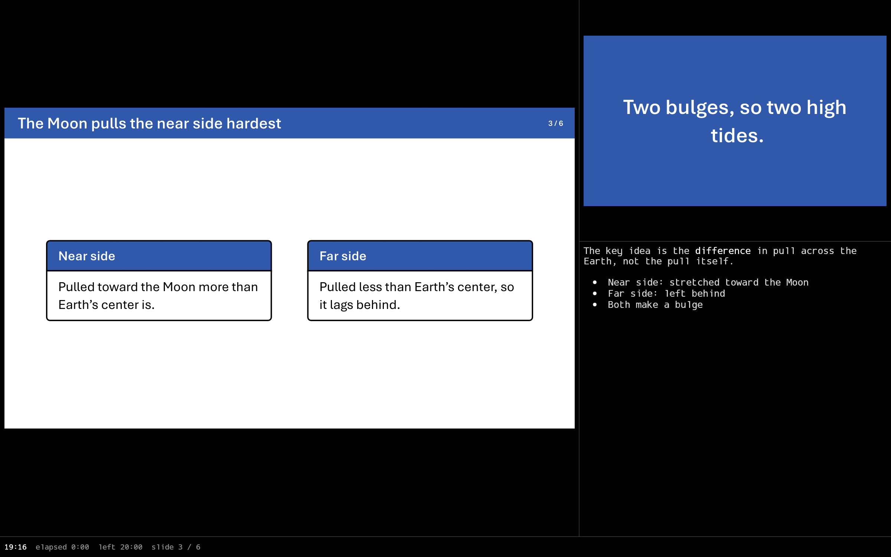
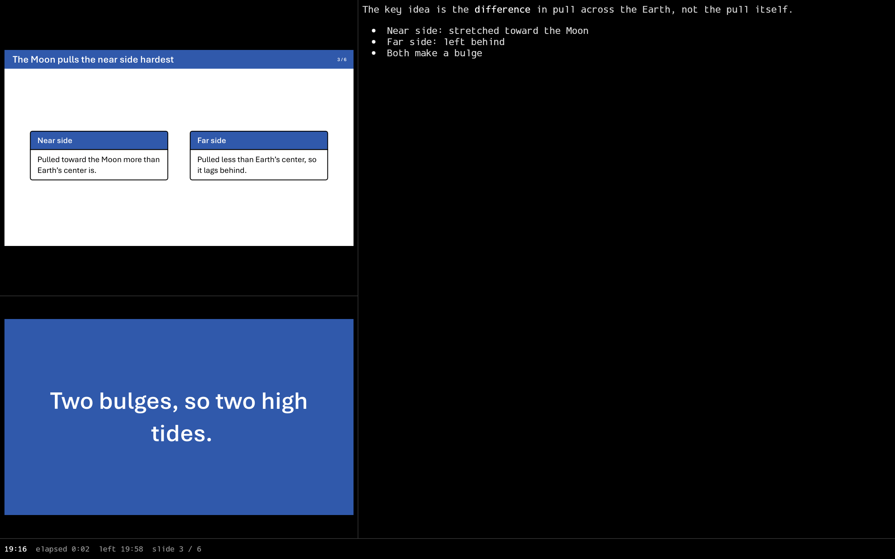
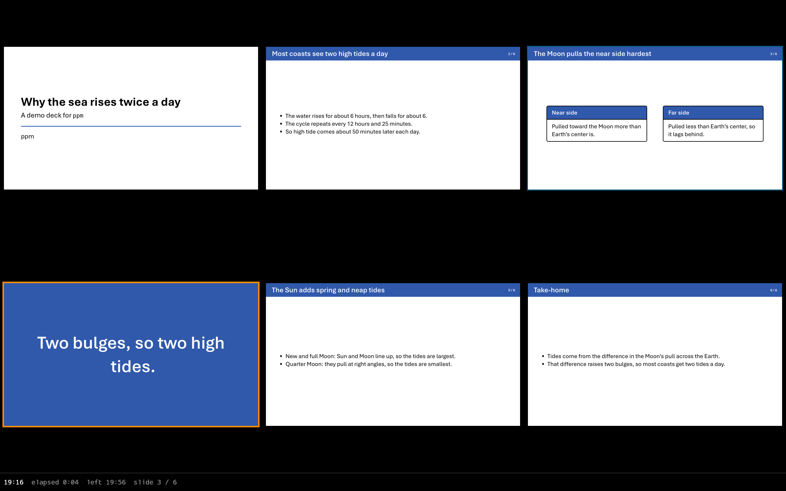
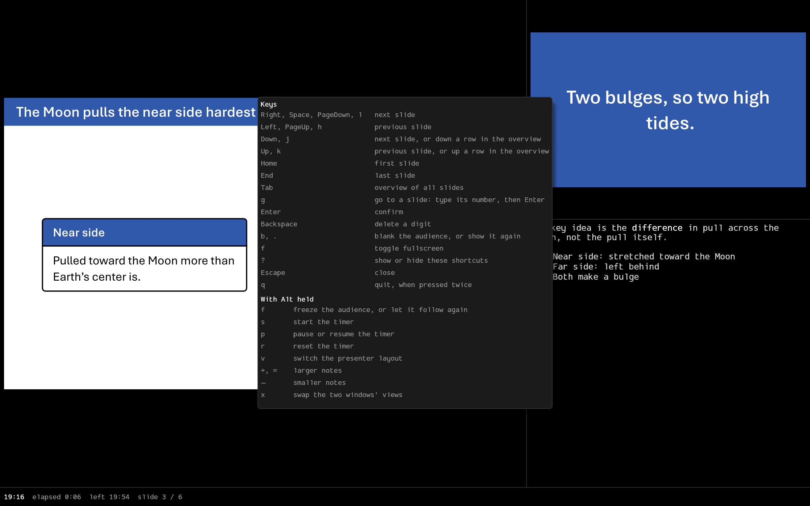

# ppm (pdf-presenter-mode)

A light presenter console for PDF slide decks, with speaker notes and a talk timer.



## Description

`ppm` shows a PDF fullscreen on the projector and a presenter view on the laptop.
The presenter view holds the current slide, the next slide, Markdown speaker notes and a status bar with the clock and timers.
It was built for decks made with [typslides](https://typst.app/universe/package/typslides), but it presents any PDF, one page per slide.

Speaker notes use the [pdfpc](https://pdfpc.github.io) format 2 JSON.
`ppm` reads them from a file attached to the PDF, from `<deck>.pdfpc` beside it, or from `--notes`.
It reloads the deck when the PDF or the notes file changes, so `typst watch` updates a running talk.

It is written in Rust with egui and the hayro PDF renderer.
It targets Linux on Wayland and is developed on Hyprland.

## Getting Started

### Dependencies

* Linux with a Wayland compositor.
* Nix with flakes, to build and install.
* On a host other than NixOS, [nixGL](https://github.com/nix-community/nixGL) for the GL driver.

### Installing

Install the flake's package into your profile:

```
nix profile install github:ramirc0/pdf-presenter-mode
```

Outside NixOS, wrap `ppm` with nixGL, for example `nixGLIntel ppm deck.pdf`.

To build from source, enter the dev shell with `nix develop` or let direnv load it, then run `just` to list the tasks.

### Executing program

```
ppm deck.pdf
```

* With an external monitor, the audience view opens fullscreen on it and the presenter view stays on the laptop.
* `--audience DP-6` picks the monitor by connector name.
* `--windowed-audience` opens the audience view as a normal window, for rehearsal and screen sharing.
* `--duration 20` or `--end-time 14:30` sets the countdown. Both override the notes file.
* `--notes talk.pdfpc` reads the notes from that file.

Keys without a modifier:

| Keys | Action |
|---|---|
| Right, Space, PageDown, `l` | next slide |
| Left, PageUp, `h` | previous slide |
| Down, `j` / Up, `k` | next or previous slide, or a row down or up in the overview |
| Home, End | first or last slide |
| `g`, a number, Enter | go to that slide |
| Tab | overview of all slides |
| `b`, `.` | blank the audience |
| `f` | toggle fullscreen |
| `?` | show the shortcuts |
| Esc | close the overview, the shortcuts, or go-to |
| `q` twice | quit |

Keys with Alt held:

| Keys | Action |
|---|---|
| Alt+`f` | freeze the audience on the current slide |
| Alt+`s`, Alt+`p`, Alt+`r` | start, pause, or reset the timer |
| Alt+`+`, Alt+`-` | larger or smaller notes |
| Alt+`v` | switch between the slides-first and notes-first layouts |
| Alt+`x` | swap the two windows' views |

Alt+`v` switches to the notes-first layout:



Tab opens the overview, and `?` shows every shortcut:





Drag the lines between the presenter panels to resize them.
The layout, the panel sizes and the notes size are saved in `~/.local/share/ppm`.

### Speaker notes in typslides

Add this after the deck's preamble:

```typst
#let note(body) = {
  assert(type(body) == str, message: "note takes a string")
  [#metadata(body) <speaker-note>]
}
#show: deck => {
  deck
  context pdf.attach(
    "notes.pdfpc",
    bytes(json.encode((
      pdfpcFormat: 2,
      pages: query(<speaker-note>).map(n => (
        idx: n.location().page() - 1,
        label: str(n.location().page()),
        overlay: 0,
        note: n.value,
      )),
    ))),
    mime-type: "application/json",
  )
}
```

Then write notes inside slide bodies:

```typst
#slide(title: "Results")[
  - Effect size 0.4
  #note("Mention the **control group**.")
]
```

* A note is a Markdown string. Content in brackets fails the assert.
* Put notes inside slide bodies only. A note in a `title-slide` body or an outlined title also lands on the contents page.
  A note outside any slide attaches to the next page.
* A note belongs to the page it lands on, so each part of an overflowing slide keeps its own notes.
  Notes on the same page show together, in order.
* The snippet adds no pages. The notes travel inside the PDF.

## Help

```
ppm --help
```

* "The wayland library could not be loaded" means the binary was built outside the dev shell. Build inside it, or install the flake package.
* "Found no glutin configs" means GL found no driver. Run `ppm` through nixGL.
* No notes show: check that the attachment's name ends in `.pdfpc`, for example with `pdfdetach -list deck.pdf`.
  A notes file that fails to parse prints a warning and the talk opens without notes.
* A PDF caught half-written during a reload keeps the old deck on screen. `ppm` retries every second.

## Authors

Christian Ramirez

## License

This project is licensed under the MIT License. See the [LICENSE](LICENSE) file for details.

## Acknowledgments

* The UI font is [ProggyForever](https://github.com/ocornut/proggyfonts) by Omar Cornut, under the MIT License in `assets/fonts/ProggyForever-LICENSE.txt`.
* [pdfpc](https://pdfpc.github.io) defined the notes format.
* [Dais](https://crates.io/crates/dais) served as the benchmark for binary size and memory.
* [hayro](https://github.com/LaurenzV/hayro) renders the pages, and [egui](https://github.com/emilk/egui) draws the interface.
