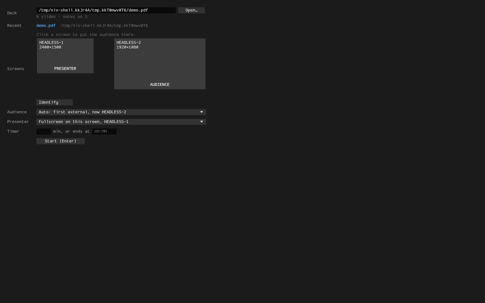

# ppm (pdf-presenter-mode)

A light presenter console for PDF slide decks, with speaker notes and a talk timer.


## Description

`ppm` shows a PDF fullscreen on the projector and a presenter view on the laptop.
The presenter view holds the current slide, the next slide, Markdown speaker notes and a status bar with the clock and timers.
A laser pointer marks spots on the projected slide and draws on it with the mouse.
It was built for decks made with [typslides](https://typst.app/universe/package/typslides), but it presents any PDF, one page per slide.

Speaker notes use the [pdfpc](https://pdfpc.github.io) format 2 JSON.
`ppm` reads them from a file attached to the PDF, from `<deck>.pdfpc` beside it, or from `--notes`.
It reloads the deck when the PDF or the notes file changes, so `typst watch` updates a running talk.

It is written in Rust with egui and the hayro PDF renderer.
It targets Linux on Wayland and is developed on Hyprland.

## Getting Started

### Dependencies

* Linux with a Wayland compositor and a GL driver.
* For the Cargo route: Rust 1.95 or newer, plus the system's Wayland, xkbcommon and EGL libraries.
  On Arch: `pacman -S rust wayland libxkbcommon libglvnd mesa`.
* For the Nix route: Nix with flakes. Outside NixOS, also [nixGL](https://github.com/nix-community/nixGL) for the GL driver.
* For the start page's Open… button: an XDG desktop portal with a file chooser, such as xdg-desktop-portal-gtk, or zenity.

### Installing

With Cargo and the system's libraries:

```
cargo install --locked --git https://github.com/ramirc0/pdf-presenter-mode
```

Use the system's `cargo` and `cc`. If a Nix profile puts its own first on `PATH`, the binary links Nix's glibc
and cannot load the system's Wayland library. Run `PATH=/usr/bin:$PATH cargo install ...` instead.

Cargo installs only the binary. To list ppm in app launchers and in "Open with" menus for PDFs, run:

```
ppm --install-desktop-entry
```

It writes `~/.local/share/applications/ppm.desktop`, which starts the binary by its full path,
and the icon `~/.local/share/icons/hicolor/scalable/apps/ppm.svg`.

With Nix, install the flake's package into your profile:

```
nix profile install github:ramirc0/pdf-presenter-mode
```

Outside NixOS, wrap the Nix build with nixGL, for example `nixGLIntel ppm deck.pdf`.
The package ships its own desktop entry and icon, so it needs no `--install-desktop-entry`.

To pin a release, name its tag: `cargo install --locked --git https://github.com/ramirc0/pdf-presenter-mode --tag v0.1.1`,
or `nix profile install github:ramirc0/pdf-presenter-mode/v0.1.1`.

To build from source, enter the dev shell with `nix develop` or let direnv load it, then run `just` to list the tasks.

### Executing program

```
ppm deck.pdf
```

* With an external monitor, the audience view opens fullscreen on it and the presenter view stays on the laptop.
* `--audience DP-6` picks the monitor by connector name.
* `--presenter eDP-1` puts the presenter view fullscreen on that monitor. The audience then skips it.
* `--windowed-audience` opens the audience view as a normal window, for rehearsal and screen sharing.
* `--duration 20` or `--end-time 14:30` sets the countdown. Both override the notes file.
* `--notes talk.pdfpc` reads the notes from that file.

Without a deck, `ppm` opens a start page. The desktop entry opens it too when started from a launcher.
A deck that does not open, from the command line or "Open with", also lands on the start page, with the reason.



* Type the deck's path and press Enter, or pick it with Open… or from the recent decks.
  The page shows the slide count and how many slides have notes, or why the deck did not open.
* Click a monitor on the map to put the audience there. Identify shows each monitor's name on it for 3 seconds.
* By default the audience takes the first external monitor, and the presenter goes fullscreen on the monitor the page is on.
* The timer starts from the notes file's countdown. Type minutes or an end time to change it, or clear both fields for no countdown.

Keys without a modifier:

| Keys | Action |
|---|---|
| Right, Space, PageDown, `l` | next slide |
| Left, PageUp, `h` | previous slide |
| Down, `j` / Up, `k` | next or previous slide, or a row down or up in the overview |
| Home, End | first or last slide |
| `g`, a number, Enter | go to that slide |
| Tab | overview of all slides |
| `b`, `.` | blank the audience |
| `f` | toggle fullscreen |
| `?` | show the shortcuts |
| Esc | close the overview, the shortcuts, or go-to |
| `q` twice | quit |

Keys with Alt held:

| Keys | Action |
|---|---|
| Alt+`f` | freeze the audience on the current slide |
| Alt+`l` | laser pointer: a red dot on the audience follows the mouse on the current slide, and a drag draws |
| Alt+`e` | erase the ink on the current slide |
| Alt+`s`, Alt+`p`, Alt+`r` | start, pause, or reset the timer |
| Alt+`+`, Alt+`-` | larger or smaller notes |
| Alt+`v` | switch between the slides-first and notes-first layouts |
| Alt+`x` | swap the two windows' views |
| Alt+`m` | move the audience to the next monitor, past the presenter's |

Alt+`v` switches to the notes-first layout:


Tab opens the overview, and `?` shows every shortcut:


With the laser on, the status bar shows LASER.
Point at the presenter's current slide, and a red dot appears at the same spot on both views.
The audience shows the dot only while it shows that slide, so a blanked or frozen audience stays clean.
The laser starts off at each launch.

Hold the left button on the current slide to draw with the laser.
Both views show the ink.
Each slide keeps its own ink until Alt+`e` erases it.
Turning the laser off keeps the ink.
A reload of the deck erases all ink. Ink is not saved.

Links on the presenter's current slide work while the laser is off.
A link to another slide goes there, and the audience follows.
A web or mail link opens in the default browser, which stays on your screen.
Links to files and to other apps' schemes do not open. Links in the notes follow the same rule.

During a talk, ppm asks the compositor to keep the screen awake, through Wayland's idle inhibit protocol.

Drag the lines between the presenter panels to resize them.
The layout, the panel sizes and the notes size are saved in `~/.local/share/ppm`.

### Warnings and the log

When something goes wrong during a talk, a red line above the presenter's status bar says what.
The audience never sees it. Each line goes away once its cause is fixed:

* a deck that did not reload, while the last good version stays on screen;
* a notes file that does not parse, while the notes from before stay;
* a monitor named with `--audience` or `--presenter` that is not connected.

Click a line to copy it, or click the log line under it to copy the log file's path.

Each run writes `~/.local/state/ppm/ppm.log`, with the run before it in `ppm.log.1`.
It holds the warnings, the decks opened, the monitors, and any crash. Attach it to a bug report.

### Speaker notes in typslides

[typslides](https://github.com/manjavacas/typslides) has no notes feature, so the deck carries a short snippet.
Add it after the deck's preamble:

```typst
#let note(body) = {
  assert(type(body) == str, message: "note takes a string")
  [#metadata(body) <speaker-note>]
}
#show: deck => {
  deck
  context pdf.attach(
    "notes.pdfpc",
    bytes(json.encode((
      pdfpcFormat: 2,
      pages: query(<speaker-note>).map(n => (
        idx: n.location().page() - 1,
        label: str(n.location().page()),
        overlay: 0,
        note: n.value,
      )),
    ))),
    mime-type: "application/json",
  )
}
```

Then write notes inside slide bodies:

```typst
#slide(title: "Results")[
  - Effect size 0.4
  #note("Mention the **control group**.")
]
```

* A note is a Markdown string. Content in brackets fails the assert.
* Put notes inside slide bodies only. A note in a `title-slide` body or an outlined title also lands on the contents page.
  A note outside any slide attaches to the next page.
* A note belongs to the page it lands on, so each part of an overflowing slide keeps its own notes.
  Notes on the same page show together, in order.
* The snippet adds no pages. The notes travel inside the PDF.

## Help

```
ppm --help
```

* "The wayland library could not be loaded" means a binary linked against Nix's glibc found no Nix Wayland library.
  Build with the system's toolchain, inside the dev shell, or install the flake package.
* "Found no glutin configs" means GL found no driver. Run a Nix build through nixGL.
* No notes show: check that the attachment's name ends in `.pdfpc`, for example with `pdfdetach -list deck.pdf`.
  A notes file that fails to parse shows a warning, and the talk opens without notes.
* A PDF caught half-written during a reload keeps the old deck on screen. `ppm` retries every second,
  and warns only if the same version fails twice.

## Authors

Christian Ramirez

## License

This project is licensed under the MIT License. See the [LICENSE](LICENSE) file for details.

## Acknowledgments

* The UI font is [ProggyForever](https://github.com/ocornut/proggyfonts) by Omar Cornut, under the MIT License in `assets/fonts/ProggyForever-LICENSE.txt`.
* [pdfpc](https://pdfpc.github.io) defined the notes format.
* [Dais](https://crates.io/crates/dais) served as the benchmark for binary size and memory.
* [hayro](https://github.com/LaurenzV/hayro) renders the pages, and [egui](https://github.com/emilk/egui) draws the interface.
